# XS 认知框架 v3.2：一套自洽的理论

## ——从「认知如何被造出来」到「认知长什么样」

> **本文性质**：理论重构稿（可独立阅读、可分享）。
> **本文不做的事**：不谈应用，不谈产品，不谈预测具体现象。
> **本文要做的事**：把此前多轮积累的全部补丁向上归因到源头，按修正后的源头，
> **重写出一套内部无矛盾、可逐条推导、每一处不闭合都写明证否程序**的理论。
> **配套文件**：`15-v3.2-gauge-fixed-framework.md`（重构对照与工程台账）、`14-v3.2-source-refactor-audit.md`（归因审计）。
> **日期**：2026-10-23

---

## 摘要

有一个反复出现的困惑：同一个人、同一道题，有人越想越清楚，有人越想越乱，还有人干脆卡住不动。
这三种结果显然不是随机的，但要把它们写成一个**能推导、能证伪**的理论，比想象中难得多。

本文给出 XS 框架的一个重构版本。做法分两步。

**第一步：归因。** 把此前全部未闭合的工程缺口摊开，逐条向上追问「这是事实未知，还是我们自己写错了定义」。
结果是：21 项未闭合项里，**13 项是源头选择不当造成的伪缺口**，可归约为 **8 个病根**；
经 8 处源头修改后，7 项消失、6 项降级、1 项缩减、7 项残留（其中真正的理论缺口只有 4 项）。

**第二步：重写。** 按修正后的源头，整套理论重写为**三层结构**：

| 层 | 名称 | 回答 |
|---|---|---|
| **L0** | 生成层 | 认知如何被造出来；三种归宿在何处分岔 |
| **L1** | 约束层 | 认知为什么能存续、为什么会失效 |
| **L2** | 动力学层 | 认知过程长什么样（峰序、形状、演化） |

本文的核心结论是一条：**L2 层的全部内容——原先分散在六篇补篇里的技术装置——可以坍缩为一条仿射定律**

$$\frac{\mathrm dU}{\mathrm dt}\;=\;\rho_{exp}\cdot\frac{\mathrm dE}{\mathrm dt}\;+\;\kappa_E\,\rho_{exp}\,(1-\rho)$$

峰序、峰距、共线性、守恒、形态分类，都是这一条关系在不同读法下的投影，而**不是**五个独立机制。

**本文对「理论」与「证据」的分离是刻意的。** 全文使用四级标记：

| 标记 | 含义 |
|---|---|
| **【定理】** | 由已声明的公理与假设**纯逻辑推出**，无经验成分 |
| **【猜想】** | 尚未验证的关键假设或推论；本文会写明它的地位与失败后果 |
| **【原型确认】** | 仅在数值原型**内部**算过；它排除实现错误，**不构成对现实的证据** |
| **【待验证】** | 已给出可执行的检验程序，但**尚未执行** |

**边界**：本文是一套**在明确假设之下自洽**的理论，不是关于现实的实证结论。
全篇最关键的未验证项只有一条（假设 A_D），本文在 §6、§12 两处明确标出它承担了哪些结论。

---

## §1 这套理论要回答什么

先把问题说清楚，否则「自洽」无从谈起。

一个认知过程，从坐到下到想清楚，中间发生了什么？至少有四个问题：

1. **它是怎么被造出来的？** 为什么会有「一个想法」这个东西，而不是一堆互不相干的联想？
2. **它为什么有时候能存续、有时候存续不了？** 同样输入，有人得到理解，有人得到幻觉。
3. **它会往哪去？** 收敛、发散、震荡——这三种归宿由什么决定？
4. **它的形状是什么？** 为什么认知过程总是先涨后落？为什么有时候「越展开越确定」？

一个诚实的理论必须对这四个问题都给出**结构性的回答**，而不是四个互不相干的观察。

本文的分工是：问题 1、2、3 属于 **L0 与 L1**；问题 4 属于 **L2**。
而 L2 是此前最难的部分——因为它需要 L1 的量与 L2 的量之间**有桥**。

> **一条贯穿全文的纪律（D1）**：**归宿由 L0–L1 决定，形状由 L2 决定。**
> 不得用形状量去推断归宿，也不得用归宿量去反推形状。
> 这条纪律不是修辞，它会一次又一次地决定某个量**能不能读**（§10）。

---

## §2 L0 生成层：认知如何被造出来

### 2.1 二分与公理

认知的第一件事是**有对象**和**有操作**。于是：

- **X（象）**：认知的对象面——被处理的东西；
- **S（运算）**：认知的运算面——对 X 所做的事。

这不是对现象的描述，而是任何认知理论**必须回答的两个分岔**：你在处理什么？你在做什么？

接下来的推理按两条轴展开：

- **事实公理 F**：`F_0 ⊆ F_1 ⊆ …` 单调。**注意「否定」是增加而不是删除**——
  被证伪的东西不离开事实集，它以「已知的假」的形式留在那里。
  这条反直觉的选择，是后面能精确定位「混沌边界」的前提。
- **运算公理 O**：可证伪、可追溯、可组合。

推导闭包记作 `Cn`。这里有一个必须澄清的细节：`Cn` **不是拟阵**——
反例 `p∧q ∉ Cn({p})` 而 `p ∈ Cn({p})`、`p∧q ∈ Cn({p,q})`，
说明 `Cn` 不满足交换性。因此「`Cn` 有几维」是个错问，正确的量是 `rank(π)`。

### 2.2 宏与加载

认知不是一次性发生，而是**把素材装载进一个运算结构**。这个结构叫**宏**，
加载的过程分三部：**展开 → 加载 → 产出**。

关键在于：**XSM（象·运算·宏的合成体）是被生成出来的，不是被预设的。**
认知的丰富程度不取决于你有多少素材，而取决于**有多少素材被真正操作过**。
这个量叫**加载度 σ**。

### 2.3 归宿：三分及其成立条件

有了生成机制，就能问它往哪去。答案是**三分**：收敛 / 震荡 / 发散。

三分的来源是三类**类比失效**（主文 §3.5）——但 v3.2 修正了它们与归宿的对应关系。

**【定理】偏离 → 归宿是一个多对多映射，不是 1:1。**
资源有界既可能导致发散（没资源继续摇），也可能导致伪收敛（为不发散而提前锁定）。
正确的对应是矩阵：

| 偏离 ＼ 归宿 | 概率性 | 发散 | 伪收敛 |
|---|---|---|---|
| **A** 事实集开放 | ✓（终局不可定） | — | ✓（槽被错误填充） |
| **B** 资源有界 | ✓ | ✓（`A_k = ∅`） | **✓（`A_k ≠ ∅` 时提前锁定）** |
| **C** 承诺可撤销 | ✓ | — | ✓（外部证伪） |

**判别条件**：资源耗尽时，`A_k ≠ ∅` 且有剩余候选 ⟹ **伪收敛**；`A_k = ∅` ⟹ **发散**。

**【定理】三分成立需要条件，辖域逐版收紧：**

| 条件 | 含义 |
|---|---|
| 资源有界 `B < ∞` ∧ 未决代价 `μ > 0` | 补篇一 |
| **资源有界 `B < ∞` ∧ 存在统计定向 `ψ̄ ≠ 0`** | **本文采用** |

`ψ̄ = 0` 时熵轨迹是鞅，震荡与混沌可以持久存在 ⟹ 此时是**四分**，
而且吸引盆会分形化，使概率权重无法鲁棒赋值。
**局部回落不妨碍归宿，只延迟归宿。**

> **边界**：本节的三分是**结构命题**，不依赖任何数值假设。
> 但「真实的认知过程是否落在三分之内」是**【猜想】**，本文不声称已验证。

---

## §3 L1 约束层：认知为什么能存续

### 3.1 两条约束，两种逻辑类型

认知要存在，必须同时满足两件不同性质的事：

| | **外约束** | **内约束** |
|---|---|---|
| 所在层 | X（对象面） | S（运算面） |
| 逻辑类型 | **构成性**（constitutive） | **规范性**（normative） |
| 内容 | 输入的物理形态 | 「必须理解」这件事本身 |
| 违反后果 | **外失效 → F2（幻觉）** | **内失效 → F1（不收敛）** |

这个不对称是整个 L1 层的骨架：**外失效产生幻觉，内失效产生不收敛。**
两者不会互相伪装，因此**失效类型是可诊断的**。

### 3.2 三个量

$$\Omega := \text{理解者},\qquad
P := H(\mathcal M \mid \varphi,\ \Omega),\qquad
Q := I(\mathcal M;\ C_{in} \mid \varphi),\qquad
U := P - Q = H(\mathcal M \mid \varphi,\ C_{in})\ \ge 0$$

- `P`：**外约束留下的欠定性**（物理形态未定，意思不明）。
- `Q`：**内约束已经吸收掉的部分**（剪枝）。
- `U`：**净未决量**。`U ≥ 0` 是**【定理】**（熵非负）。

**【定理】内约束强度有操作化定义**：

$$Q = \log_2\frac{|O_{all}|}{|O_{adm}|}$$

其中 `O_all` 是操作空间全体，`O_adm` 是被剪枝后被允许的部分。
这个量**不依赖**时间尺度 `τ`，也不依赖注入策略。

**【定理】`P` 依赖理解者，且不只是 `U` 依赖理解者。**
跨理解者混合估计给出的是 `H(M|φ)`，而

$$H(\mathcal M\mid\varphi) = H(\mathcal M\mid\varphi,\Omega) + I(\mathcal M;\Omega\mid\varphi)$$

⟹ **混合估计的偏倚恰好等于 `I(M;Ω|φ)`**——这是 `P` 定义的直接推论，**不是未知量**。
（推论：**`P̂` 的数值不可跨群体比较**，除非同时报告 `I(M;Ω|φ)`。）

### 3.3 认知存在的条件

**【定理】** `0 < H(M|φ) < ∞` ∧ `Q > 0`。
`P = 0` ⟹ 理解退化为解码；`Q = 0` ⟹ 理解退化为生成（幻觉）。

---

## §4 真正的瓶颈：U 与 Ψ 之间没有桥

到这里，我们有了两样东西：

- `U`（L1）：**存量**——此刻还有多少没想清楚；
- `Ψ`（L2）：**通量**——此刻被推进还是被拉回。

认知理论必须能把它们接起来，否则「越想越清楚」只是一句文学描写，而不是命题。
而这个桥此前一直是断的——它被登记为 B-B19，从 v3.1 中期一直到源头重构审计，都写着「已定位，未闭合」。

**为什么断？** 回头看会发现，**框架里 `Ψ` 与 `U` 被写成了同一个定义式**：

| 出处 | 写法 | 实际角色 |
|---|---|---|
| 补篇二 §1.1 | `Ψ(k) := P(k) − Q(k)` | 动力学层的**通量**（驱动 `E` 的力） |
| 补篇三 §3.3 | `Ψ = P − Q` [bit] | 「净未决信息量」——**存量** |
| 补篇四 / 五 | `U := P − Q = H(M\|φ,C_in)` | 约束层的**存量** |
| 补篇二 §2 命题 2.1 | `E(k+1) − E(k) = Ψ(k)` | `Ψ` 是**速率** |

三处不能同时为真。根源是：**符号 `P`、`Q` 本身有「水平」与「通量」二义性，而框架从未区分。**

这是一件值得单独记一笔的事，因为它的后果比看上去大：
**桥之所以长期难合，是因为它被伪装成了恒等式。**
写成恒等式的东西，是不需要证明的；于是没有人去问「它到底在哪些条件下成立」。

---

## §5 澄清记号：存量与通量分层

**【定理】记号分层（v3.2 修正）**

| 记号 | 定义 | 量纲 | 所属层 |
|---|---|---|---|
| `P_lvl`, `Q_lvl` | 水平量：欠定性、剪枝量 | bit | L1 |
| `U := P_lvl − Q_lvl` | **存量**：净未决量 | bit | L1 |
| `P_flx`, `Q_flx` | 通量：每步的注入 / 剪枝速率 | bit/步 | L2 |
| `Ψ := P_flx − Q_flx ≡ dE/dk` | **通量**：净驱动力 | bit/步 | L2 |

分层之后，桥的问题恢复成它本来的样子：**两条不同量纲、不同层的序列，凭什么相关？**
这不是恒等式，是一个**待检验的关系**——而一旦它是待检验的，它就可以被证伪。
这是全文最重要的一次澄清，后面所有内容都建立在它之上。

同时，势的分解保持不变：

**【定理】** `Ψ = ψ̄ + ξ`，其中 `ψ̄` 是统计定向（长期方向），`ξ` 是涨落（局部回落的来源）。
于是 `E` 是**带漂移的随机游走**：

$$E(k+1) - E(k) = \Psi(k) = \bar\psi + \xi(k)$$

**【定理】漂移-扩散的必然性**。若 `ψ̄ ≠ 0`，则 `E` 在有界熵区间上**以概率 1 在有限时间内触及某一边界**：
`ψ̄ < 0` ⟹ 收敛；`ψ̄ > 0` ⟹ 临界跃迁，若跃迁不可构造则发散。
**因此震荡必然消亡**——震荡是 `Ψ ≈ 0` 处的驻留。

**【定理】尺度应当内置**。`h`（显著度）与 `w`（窗口）若从外部塞入，就是无第一原理的旋钮。
正确的做法是用已有的 `Ψ = ψ̄ + ξ` 分解定义**分离尺度**：

$$\tau^\* := \min\Big\{\tau:\ \frac{\mathrm{Var}(\xi_\tau)}{\bar\psi^{\,2}} < \eta\Big\}$$

于是「选 `h` 和 `w`」被换成「选 `η`」，而 `η` 有明确含义：**把涨落误读为定向的可接受错误率**。
所有形状命题一律理解为「**相对于 `τ*`**」。
（残余：`η` 的取值原则未定，见 §12。）

---

## §6 假设 A_D：以及它的冗余

现在我们有理由去找一条同时兼容 `E` 与 `U` 的动力学。取最简单的一条。

> **【猜想】假设 A_D（展开 / 消解双速率线性分解）**
> 每一步的演化由两个子过程**线性叠加**：
> - **展开（expansion）**，投入 `a ≥ 0`：`dE += a·e₊`，`dU += a·u₊`
> - **消解（resolution）**，投入 `b ≥ 0`：`dE −= b·e₋`，`dU −= b·u₋`
>
> 四个系数均为正。

**这条猜想承担了 L2 层的全部内容。** 它不是「显然的」，它是**未经验证的建模假设**。
但它在框架中的地位特殊：它**足够弱**（线性、两项、无噪声记忆），
又**足够强**（能同时产生 `E` 的峰与 `U` 的峰，且两峰可以错开）。

### 6.1 它的第一个问题：六个量，三个自由度

A_D 写的是六个量 `(a, b, e₊, e₋, u₊, u₋)`。但它们**只通过四个乘积进入动力学**：

$$a\,e_+,\qquad b\,e_-,\qquad a\,u_+,\qquad b\,u_-$$

也就是说，**六个参数只表达了三个自由度**。多出来的那个不是物理事实，是我们写进去的冗余。

这个冗余有一个显式形式：**λ-规范**。对任意 `λ ≠ 0`，

$$a \mapsto \lambda a,\quad e_+ \mapsto e_+/\lambda,\quad u_+ \mapsto u_+/\lambda$$

保持 `(a·e₊, b·e₋, a·u₊, b·u₋)` 不变，因而**保持整条 `(E, U)` 轨迹逐点不变**。

> **【原型确认】** 在数值原型上把 `λ` 从 0.25 拉到 4（16 倍），
> `θ_E` 随之变 16 倍，而 `max|ΔE| = max|ΔU| = 0.000e+00`。
> 这**只说明原型实现是自洽的**，不构成对现实的任何断言。

**为什么这件事重要**：如果不去掉这个冗余，后面会得出「四个系数绝对值不可辨识」这样的结论，
并据此断言「ρ 的数值标不出来」。但那不是世界的性质，是**我们自己的坐标选择**。

### 6.2 它的第二个问题：单一驱动被误列为额外前提

A_D 原文即「**同一个** `a`、**同一个** `b`」同时驱动 `dE` 与 `dU`。
换句话说，**「`E` 与 `U` 由同一过程驱动」已经包含在 A_D 的定义里**。

而此前的定理 6.10、6.11 却都写作「在 `A_D` **∧ 共享 `r`** 下」——
把已经在定义里的东西再列一遍，就凭空制造出一个「额外假设」，
进而制造出两个本不该存在的洞：

- 「共享 `r` 没被检验」；
- 「违反共享与违反 A_D 不可区分」。

**修正**：把单一驱动**写进** A_D 的定义（附款），而不是列成定理的前提。
⟹ 「非共享驱动」不再是 `¬A_D` 的一个子类，而只是「**测错了对象**」。

**修正后的 A_D（附款）**：

> **A_D 附款（single-drive）**：存在唯一过程 `(a_k, b_k)`；`dE` 与 `dU` 由**同一对** `(a_k, b_k)` 驱动。
> 凡 `E` 与 `U` 由不同过程驱动者，不属于本框架所论的「同一认知过程的 `E` 与 `U`」。

---

## §7 规范固定与主定理：一条仿射定律

### 7.1 换一套坐标

定义两个新量：

$$s := \frac{r}{\theta_E} = \frac{a\,e_+}{b\,e_-}\quad(\textbf{归一化投入比，无量纲}),\qquad
\kappa_E := b\,e_-\quad(\textbf{单一时间尺度})$$

再记

$$\theta_E := \frac{e_-}{e_+},\quad \theta_U := \frac{u_-}{u_+},\quad
\rho_{exp} := \frac{u_+}{e_+},\quad \rho_{res} := \frac{u_-}{e_-},\quad
\rho := \frac{\rho_{res}}{\rho_{exp}} = \frac{\theta_U}{\theta_E}$$

于是 A_D **等价于**

$$\frac{\mathrm dE}{\mathrm dt} = \kappa_E\,(s-1),\qquad\qquad
\frac{\mathrm dU}{\mathrm dt} = \kappa_E\,\rho_{exp}\,(s-\rho)$$

（第一式：`dE = b(r e₊ − e₋) = b e₋(r e₊/e₋ − 1) = κ_E(s−1)`；
第二式：`dU = b u₊(r − θ_U) = b u₊θ_E(s − θ_U/θ_E) = κ_Eρ_exp(s−ρ)`，用到 `b u₊θ_E = b e₋(u₊/e₊) = κ_Eρ_exp`。）

**消去 `s`**，得到——

### 主定理（仿射定律）

$$\boxed{\;\frac{\mathrm dU}{\mathrm dt} \;=\; \rho_{exp}\cdot\frac{\mathrm dE}{\mathrm dt} \;+\; \kappa_E\,\rho_{exp}\,(1-\rho)\;}$$

**【定理】** 这是 A_D 的代数推论，不含任何新的假设。

**内禀参数：三个无量纲数 `(s, ρ_exp, ρ)` 加一个时间单位 `κ_E`**，全部 λ-规范不变。
λ-规范自由度**在定义层被消灭**。

### 7.2 为什么这条定律重要

因为它把 L2 层**压成了一个东西**。此前 L2 层的全部技术装置——峰序、峰距、共线性、守恒——
各自带着不同的前提、不同的辖域、不同的适用范围，彼此还互相打架。
现在它们有了同一个母体：**一条仿射关系**。

后面三节分别讲这条定律的三种用途：
**读形状**（§8）、**分类形态**（§9）、**判定什么能读**（§10）。

### 7.3 边界层：`U ≥ 0` 要求 A_D 带状态依赖

`U = H(M|φ,C_in) ≥ 0` 是**定理**，而线性 A_D 会把 `U` 推向负值。
工程上只能截断——**截断是承认动力学跑出了状态空间**。

> **【猜想】A_D⁺（状态依赖修正）**
> $$\frac{\mathrm dU}{\mathrm dt} = a\,u_+ - b\,u_-\cdot g(U),\qquad g(0)=0,\ g\ \text{单调增}$$

物理含义：**无可消解时，消解速率归零。**

**【定理】** 在 `g(0)=0` 且 `g` 单调增的条件下，`U = 0` 是**稳定不动点**，
不是截断点——所以状态空间是被动力学**保护**的，不是被工程**修补**的。

**代价**：`A_D⁺` 下，主定理要改写成

$$\frac{\mathrm dU}{\mathrm dt} = \rho_{exp}\frac{\mathrm dE}{\mathrm dt} + \kappa_E\rho_{exp}\bigl(1-\rho\,g(U)\bigr)$$

⟹ 仿射性只在下述辖域内成立：**`U` 远离 0**。
这是全文辖域最紧的一条限制，§12 会登记。

---

## §8 第一种用途：形状理论

主定理给出两个可观测量和三个参数。逐个看它能读出什么。

设 `U − ρ_exp·E` 对 `k` 作图。

### 8.1 五个投影

**【定理】投影 P1（共线性）**。在 A_D 下，对**每一条样本路径**，

$$U(k) - \rho_{exp}\,E(k) = \alpha + \beta\,k$$

即 `U` 对 `E` 的图是**逐样本直线**，斜率 `ρ_exp`，纵截距 `α`。
更实用的写法：把 `(E(k), U(k))` 看作点云，则

$$\min_v \bigl\|\Pi^{\perp}(vU - E)\bigr\| \equiv 0,\qquad v^\* = \frac{1}{\rho_{exp}}$$

**【定理】投影 P2（`ρ_exp` 可标定）**。`ρ_exp` 就是上面那条直线的斜率。**不需要任何外部标定。**

**【定理】投影 P3（峰序）**。设 `s(k)` 单调下降。`E` 的峰在 `s = 1`，`U` 的峰在 `s = ρ`。
于是

$$\rho_{res} > \rho_{exp}\ \Longleftrightarrow\ \theta_E < \theta_U\ \Longleftrightarrow\ k^\*_U < k^\*_E$$

（`r` 单调下降 ⟹ 较大的 `θ` 被先跨越。）
且**中间相的性质完全由峰序决定**：

- `k*_U < k*_E` ⟹ 中间相为 `(+,-)`：**钻研相**（`E` 还在扩大，`U` 已开始下降）；
- `k*_E < k*_U` ⟹ 中间相为 `(-,+)`：**空洞相**（`E` 已在收窄，`U` 仍在上升）。

**【定理】投影 P4（守恒）**。`U^s(k) − E(k)` 关于 `k` 仿射，且**与 `r` 及噪声无关**
⟹ 峰序**逐样本守恒**（零判反率）。

**【定理】投影 P5（`ρ` 的数值）**。仿射直线的**截距绝对值**给出

$$\beta = dt\cdot\kappa_E\,(\rho_{exp}-\rho_{res})$$

这才是「`ρ` 的数值」的入口。

### 8.2 这张表就是全部诊断书

把五个投影并排看：

| 投影 | 读的是仿射式的哪一处 | 需要 `κ_E`？ | 依赖调度？ |
|---|---|---|---|
| P1 共线性 | 形状本身 | 否 | **否** |
| P2 `ρ_exp` | 斜率 | 否 | **否** |
| P3 峰序 | 截距**符号** | 否 | **否** |
| P4 守恒 | 积分形式 | 否 | 否 |
| P5 `ρ` 的数值 | 截距**绝对值** | **是** | **是** |

**这张表解释了此前一个长期的技术困难。**

此前有一份「峰距标定程序」，试图从**峰在时间轴上的间距**反解 `ρ` 的数值。
在非对数斜坡的调度下，它偏了 36.8%–76.5%。

**为什么？因为峰距法在做的事情是越层的。**
峰距读的是形状层的量，却想从中取出 C 级（需外部单位）的信息。
**偏差不是公式的缺陷，是它在读一个本来就读不出来的数。**

**【原型确认】** 在同一批轨迹上比较两种读法：

| 调度族 | 峰距法相对误差（中位） | 共线性法误差（最大） |
|---|---|---|
| 对数斜坡 | 0.38% | **0.000e+00** |
| 线性 | 63.02% | **0.000e+00** |
| S 形 | 57.73% | **0.000e+00** |
| 阶跃块 | 20.75% | **0.000e+00** |

⟹ **标定程序重排**：首选可观测量改为**仿射系数**（斜率 → `ρ_exp`；截距符号 → 峰序）；
峰距降级为**交叉检验**，仅在调度族已被独立辨识时使用。

> **边界**：上表是**无噪声**原型内的比较。有噪声时两种方法的方差对比**尚未做**（§12）。

### 8.3 顺带解决的两个小问题

**【定理】承载量应记为 `m_eff`。**
`U` 是熵（bit），`m := |A_k|` 是计数（无量纲）；只有候选均匀分布时才有 `U = log₂ m`。
定义

$$m_{eff}(k) := 2^{\,U(k)}$$

并声明：**峰承载于 `m_eff`，不承载于 `m`**。
于是「峰承载在什么上」不再是待证命题，而是定义的直接结果；
且 `m_eff ≤ m`（等号在均匀分布取到），保留了原有直觉；
`m_eff` 连续，还顺带消掉了 `|A_k|` 的整数跳变带来的「峰后陡度」问题。

**【定理】单峰性是 E 层命题，不是路径层命题。**
路径层（单条样本轨迹）上，单峰率实测为 **0.000**；E 层（统计平均后）为 **1.000**。
两者都「真」，因为它们是**关于不同尺度的命题**。
⟹ 一切形状命题都必须标注「相对于 `τ*`」（§5）。

---

## §9 第二种用途：形态分类

现在把 `E` 的符号与 `U` 的符号放在一起看。由主定理：

$$\operatorname{sign}\frac{\mathrm dE}{\mathrm dt} = \operatorname{sign}(s-1),\qquad
\operatorname{sign}\frac{\mathrm dU}{\mathrm dt} = \operatorname{sign}(s-\rho)$$

（因为 `κ_E > 0`、`κ_Eρ_exp > 0`。）

于是整个四象限分类塌缩成 **`(s, ρ)` 平面上的两块楔形区域**。



*图 1　`(s, ρ)` 平面的楔形分类。竖线 `s = 1` 与对角线 `ρ = s` 划出四个区域：
右上「越想越乱」、左下「正常收敛」，两片以 `(1, 1)` 为顶点的楔形分别是**钻研相**（需 `ρ > 1`）与**空洞相**（需 `ρ < 1`）。
虚线箭头为 `s` 随时间下降的方向：上轨先过 `s = ρ`（U 峰在前），下轨先过 `s = 1`（E 峰在前）。*

### 9.1 楔形

**【定理】楔形分类**。
（i）中间相（`E` 与 `U` 异号）**存在**当且仅当 `ρ ≠ 1`；
（ii）中间相是哪一半，由 `ρ` 相对 1 的位置决定：`ρ > 1` ⟹ **钻研相**；`ρ < 1` ⟹ **空洞相**；
（iii）楔形的张开度恰为 `|1 − ρ|`——`ρ → 1` 时楔形塌陷，中间相消失。

证明只需两行：两个符号分别是 `sign(s−1)` 与 `sign(s−ρ)`，异号 ⟺ `s` 严格介于 `1` 与 `ρ` 之间。

### 9.2 这比原来的说法强在哪

此前的定理 5.2′ 写作

$$\operatorname{sign}(\bar\psi) = -\operatorname{sign}\!\left(\frac{\mathrm dU}{\mathrm dk}\right)\ \Longleftrightarrow\ \rho_{res} > \rho_{exp} \ \wedge\ r \in (\theta_E,\ \theta_U)$$

它只写了 `ρ_res > ρ_exp` 一支，且用了四个参数。
规范固定之后，同样的内容写成：**`ρ > 1` 且 `s ∈ (1, ρ)`**——两个参数，两个分支。

更进一步，**定理 5.2′ 的无条件版本（猜想 5.2）已经被证否**：
存在三类反例模型（M-A 正常收敛、M-B 越想越乱、M-C 钻研型），
其中 M-A 与 M-B 都不满足「未决量下降 = 正在收敛」这个直觉。
所以正确的说法是：**反号不是无条件的，它在一类系统上成立，在另一类上恰好反过来。**

### 9.3 归宿在 L2 的一个投影

由定理 6.2″（§5），归宿由漂移 `ψ̄` 决定。在 A_D 之下：

| 归宿 | A_D 下的实现条件 |
|---|---|
| **收敛** | `ψ̄ < 0` ⟺ `s̄ < 1`（`s̄` 为 `s` 的时间平均） |
| **发散** | `ψ̄ > 0` ⟺ `s̄ > 1`，且跃迁不可构造 |
| **震荡** | `s̄ ≈ 1`（`Ψ ≈ 0` 驻留）且 `Var(ξ) > 0`；但 `ψ̄ ≠ 0` 时必然消亡 ⟹ 持久震荡需 `ψ̄ = 0` ⟹ **四分** |

> **必须说清（D1 的又一次应用）**：这是**归宿在 L2 的一个动力学实现**，
> **不是**归宿的证明。归宿的原始依据仍在 L0（事实开放 / 资源有界 / 承诺可撤销）与 L1（双约束）。
> A_D 本身的地位是**【猜想】**（§6）。

---

## §10 第三种用途：能读什么、不能读什么

这是本文最实用的一节，也是纪律 D1 真正落地的地方。

### 10.1 两类「不可辨识」必须分开

| | **(a) 规范冗余**造成的**伪**不可辨识 | **(b) 真**不可辨识 |
|---|---|---|
| 症状 | 换个参数化就「可标定」了 | 任何参数化都不可分离 |
| 本框架的实例 | λ-规范 ⟹ 四系数绝对值不可辨识 | `κ_E` 需要**外部时间单位** |
| 处置 | **改源头即可消灭**（§7.1 已消灭） | **必须引入新的观测类别**（§11） |

> **把 (a) 当 (b)，会徒劳地去找外部标定。**
> 本文最重要的一次工程纠错，正是把 B-B23 的主体从 (a) 归到 (a) 并消灭掉。

### 10.2 可辨识性四级分类

**【定理】四级分类**

| 级 | 量 | 从仿射式的哪一处读 | 需要 `κ_E`？ | 依赖调度？ | 状态 |
|---|---|---|---|---|---|
| **A** | `ρ_exp` | 斜率 | 否 | 否 | **自足可标定** |
| **B** | `sign(1 − ρ)` ⟹ 峰序 | 截距**符号** | 否 | 否 | **自足可标定** |
| **C** | `ρ` 的**数值**、`κ_E` | 截距**绝对值** | **是** | **是** | **需外部观测** |
| **D** | `a, b, e₊, e₋, u₊, u₋` 的**绝对值** | — | — | — | **伪目标**（λ-规范冗余） |

**读法**：**A、B 级自足；C 级需要外部单位；D 级根本不该去辨识。**

### 10.3 一个可独立核对的一致性检验

补篇九曾用另一条路径（λ-规范不变性）得出「独立不变量恰 2 个」。
本文用另一条路径（A 级 + B 级）得到「自足可读的恰 2 个」。
**两条独立路径得数相同，说明这不是巧合，而是同一个可辨识性结构的两次计数。**

### 10.4 为什么 C 级「必须」依赖外部单位

**【定理】第二可辨识视界**。
在不观测 `s(k)`（或其调度律）的条件下，由 `(E, U)` 双序列可辨识的信息**恰为 2 个自由度**
（`ρ_exp` 与每步斜率 `β = dt·κ_E(ρ_exp − ρ_res)`）；
`(κ_E, ρ)` **只有一个组合 `κ_E(ρ_exp − ρ_res)` 可辨，二者不可分离**。

**证明要点**：
（i）`U − ρ_exp·E` 对 `k` 仿射 ⟹ 轨迹只给出两个数；
（ii）`β = dt·κ_E·ρ_exp(1−ρ)` 是一个方程、两个未知数；
（iii）即使补上 `Ψ` 的独立标定，也**不增秩**：在 `U` 的内点峰处 `ΔE = dt·κ_E(ρ−1)`，
而 `β = −ρ_exp·ΔE`，两条式子**线性相关**。

**这一条纠正了此前的一个说法。** 有人曾提出 `κ_E = Ψ(k*_U)/(ρ−1)` 作为标定路径——
但它需要 `ρ`，而 `ρ` 需要 `κ_E`，**是循环的**。
它是一条**记账恒等式**，不是一条标定路径。

---

## §11 读不出来的部分怎么办

C 级要闭合，需要的不是更多数据，而是**新的一类观测**。

**【定理】实验性规范固定**。
λ-规范自由度之所以存在，是因为 `a`、`b` 的**「单位」未被固定**——
`G_λ` 的实质就是「换一个单位来数展开动作」。
因此存在**第二种（非代数的）规范固定方式**：**用固定动作计数固定 `a` 与 `b` 的单位**。

具体地：

- **臂 1**：固定展开 1 次（`a = 1`），测 `ΔE`、`ΔU` ⟹ `e₊ = ΔE`、`u₊ = ΔU`；
- **臂 2**：固定消解 1 次（`b = 1`），测 `ΔE`、`ΔU` ⟹ `e₋ = −ΔE`、`u₋ = −ΔU`。

于是

$$\theta_E = \frac{e_-}{e_+},\quad \theta_U = \frac{u_-}{u_+},\quad
\rho_{exp} = \frac{u_+}{e_+},\quad \rho_{res} = \frac{u_-}{e_-},\quad \kappa_E = b\,e_-$$

**全部可测** ⟹ C 级闭合，**且无需任何外部时间标定**。

> **这是一个漂亮的对应**：代数上固定的是**记号**，实验上固定的是**单位**；两者做的是同一件事。
> 规范的自由，本质上是「我们用什么单位数」的自由。

**若不愿做介入性实验**，则退回两条路：
（i）给出 `s(k)` 的观测（例如过程追踪的投入计数）；
（ii）给出时间单位的绝对标定。

---

## §12 未闭合的部分：猜想登记表

自洽不等于完备。下面把本文**没有闭合**的东西集中列出，
每一条都写明：它是什么、它挂在哪、怎么才能被检验、失败了会怎样。

### 12.1 关键猜想

| 编号 | 陈述 | 承担了哪些结论 | 证否程序 | 失败后果 |
|---|---|---|---|---|
| **A_D** | 每一步的演化由展开与消解两个线性子过程叠加，且由同一对 `(a_k, b_k)` 驱动 | **L2 层的全部**：主定理、五个投影、楔形分类、峰序 | §12.3 的 R43′ 与补篇九推论 6.13（任务内线性失配残差） | L2 层整体失效，退回「形状无理论」的状态 |
| **A_D⁺ 的 `g`** | `g(0)=0`、`g` 单调增；**具体形式未知** | `U ≥ 0` 的保护；仿射性在 `U` 远离 0 时成立 | §12.3 的 R32（残差反演 `g`） | 触底邻域的仿射偏离量未知；补篇九全部实验结论的辖域须加限定 |
| **`ψ̄ ≠ 0`** | 存在统计定向 | 三分成立（否则四分） | 观测漂移符号本身 | 震荡与混沌可持久，概率权重不可鲁棒赋值 |
| **`η` 的取值原则** | 尺度分离阈值 | 「相对于 `τ*`」的一切形状命题 | 由「回落被误读为定向」的可接受错误率反解 | 尺度选择仍是外部旋钮，无第一原理 |
| **`A_expand`** | 存在 `k` 使候选数 `≥ 2` | 峰的存在性 | 单步命中 `0→1` 的失败模式 | 一步命中的过程没有峰 |

### 12.2 剩余缺口（按重要性）

| 编号 | 内容 | 状态 |
|---|---|---|
| **B-B22** | **A_D 的经验地位**：它是否描述真实认知过程 | **开放**。这是本文唯一无法在框架内部解决的缺口——它需要**外部经验证据** |
| **B-B42 / B-B45** | C 级的外部标定 / `(κ_E, ρ)` 的分离 | **有闭合路径**（§11，命题 6.3），**尚未执行** |
| **B-B43** | `g(U)` 的形式 | **部分推进**（残差可反演 `g` 的**变异**），形式未知 |
| **B-B44** | `η` 的取值原则 | **开放** |
| 其他 | 跨人群验证、多峰与震荡时长的关系、形式化编译 | 工程与经验项，本文不涉及 |

### 12.3 待验证程序

| 编号 | 检验什么 | 判据 |
|---|---|---|
| **R43′** | 桥（B-B19）的可证伪形式 `β = −ρ_exp·Ψ(k*_U)`，其中 `Ψ` **独立标定**（经 `P_flx/Q_flx`） | 在故意违反 A_D 的注入族上应系统性失效；在 A_D 上应 ≈ 0 |
| **R32** | 残差反演 `g`：共线残差 ≡ `g(U)` 沿路径的变异 | 已知 `g` 的合成轨迹上，反演值应与真值一致 |
| **R43** | A_D⁺ 下仿射偏离量的**形状**是否确由 `g` 的变异决定 | 在已知 `g(U)` 的合成轨迹上，`U − ρ_exp·E` 的偏离曲线应与 `∫(g−ḡ)` 一致 |
| **R45** | 固定动作计数能否闭合 C 级 | 四臂测得的 `(e₊, e₋, u₊, u₋)` 应与回归所得 `(ρ_exp, β)` 自洽 |

> **一处必须承认的重言**。若在 R43′ 中用 `ΔE` 代替独立标定的 `Ψ`，
> 该等式会**退化为重言**——因为「`U` 在内点峰取极值」已蕴含 `ΔU = 0`，
> 再由仿射形式即得 `ρ_exp·ΔE = −β`。
> **R43′ 的全部内容都压在「`Ψ` 独立标定」这一个前提上**，
> 而这恰恰也是它作为「桥的检验」的资格来源。

### 12.4 一处对既有结论的修正

补篇九在升级 B-B22 时写下「**A_D 目前无任何已登记的有效证否途径**」。
按 §6.2 的单一驱动附款落地后，这句话**不再准确**：
「非共享驱动也触发残差」这一顾虑（T16）不再是假阳性来源——
非共享驱动意味着**测的不是同一个过程**，不在框架辖域内。
**补篇九推论 6.13（任务内线性失配残差）本身就是 A_D 的有效证否途径。**

⟹ **B-B22 的真正内容收缩为「A_D 的经验地位」**，
严重程度由「框架自证困难」下调为「需外部经验证据」。
**这不等于 A_D 已获经验支持**，只是说它的可证否性不再是障碍。

---

## §13 边界

### 13.1 辖域声明

1. **理论层**：本文的定理全部是**在 A_D 之下**的推导。A_D 是**【猜想】**。
2. **辖域层**：A_D⁺ 之下，仿射性与五个投影只在 **`U` 远离 0** 时成立。
3. **尺度层**：一切形状命题都在「**相对于 `τ*`**」的意义下成立。
4. **数值层**：本文引用的数值比较（§8.2 的表、§6.1 的规范不变性）来自**无噪声**原型，
   且只覆盖四个调度族（对数斜坡 / 线性 / S 形 / 阶跃块）。
   **它们排除实现错误，不构成对现实的证据。**
5. **层间层**：归宿属 L0–L1，形状属 L2；越层读取无效（§8.2 是本纪律的第一个代价）。

### 13.2 不能声称的

1. **不能说 A_D 被证明了。** 它是全篇最关键的未验证假设。
2. **不能说 B-B22 已闭合。** 本文只是把它的内容从「无证否途径」重新定性为「需外部经验证据」。
3. **不能说共线性法在任何数据上都优于峰距法。** 现有比较是**无噪声**的；有噪声时的方差对比**未做**。
4. **不能说 `m_eff` 就是「候选个数」。** 它是熵的指数，只在均匀分布时等于 `|A_k|`。
5. **不能说 R43′ / R32 / R45 已验证。** 它们都是**【待验证】**。
6. **不能说 §9.3 的归宿实现是归宿的证明。** D1 纪律。
7. **不能说本文是关于现实的理论。** 它是一套**在明确假设下自洽**的理论；
   它的经验检验程序已写明，但**尚未执行**。

### 13.3 自洽性的三重检验

| 检验 | 含义 | 本文状态 |
|---|---|---|
| **逻辑闭合** | 每条结论的推导链完整，不引用未声明的假设 | ✔ 依赖图见附录 A |
| **参数闭合** | 内禀参数数目 = 可观测量数目（不多不少） | ✔ §10.4：`(E,U)` 给 2 个自由度，A 级 + B 级 = 2，与独立路径吻合 |
| **反例闭合** | 每条猜想都配有证否程序与失败后果 | ✔ §12.1 |

> **本文的立场**：一个理论的质量不取决于它有多少结论，
> 而取决于它**把不确定的部分摆在哪、并且能不能被推翻**。
> 上面那张登记表就是本文的诚实边界。

---

## 附录 A · 依赖图

```
        公理 F / O  ─┐
                      ├─▶ L0 生成层 ──▶ 三分（收敛/发散/震荡）
        宏 / 加载度 ─┘         │
                                │  决定归宿
        外约束 ─┐                │
        内约束 ─┴─▶ L1 约束层 ──▶ U（存量，净未决量）
                                │
                                │  ★ 需要桥
                                ▼
        Ψ（通量）─▶ L2 动力学层 ──▶ 【猜想 A_D】
                                │
                                ├─▶ 规范固定：s, κ_E, ρ_exp, ρ
                                ├─▶ 主定理（仿射定律）
                                │        ├─▶ P1 共线性 ─▶ 残差判据
                                │        ├─▶ P2 ρ_exp 可标定
                                │        ├─▶ P3 峰序 ─▶ 形态分类
                                │        ├─▶ P4 守恒
                                │        └─▶ P5 ρ 数值 ─▶ 需外部单位（C 级）
                                └─▶ A_D⁺（g(U)）──▶ 辖域：U 远离 0

        B-B22（A_D 的经验地位）──▶ 唯一需外部证据的缺口
        B-B45（κ_E 与 ρ 的分离）──▶ 固定动作计数（命题 6.3）可闭合
```

## 附录 B · 记号表

| 记号 | 含义 | 量纲 |
|---|---|---|
| `X` / `S` | 象 / 运算 | — |
| `F` / `O` | 事实公理 / 运算公理 | — |
| `M` / `σ` | 宏 / 加载度 | — |
| `φ` / `Ω` / `C_in` | 已知 / 理解者 / 输入约束 | — |
| `P` / `Q` / `U` | 欠定性 / 剪枝量 / **净未决量（存量）** | bit |
| `Ψ` / `ψ̄` / `ξ` | **净驱动力（通量）** / 定向 / 涨落 | bit/步 |
| `E` / `m` / `m_eff` | 展开度（熵） / 候选数 / 有效候选数 `2^U` | bit / 计数 / 计数 |
| `a` / `b` | 展开投入 / 消解投入 | — |
| `e₊`/`e₋`/`u₊`/`u₋` | 四个单位系数 | — |
| `r` | 投入比 `a/b` | 无量纲 |
| `θ_E` / `θ_U` | `Ψ=0` / `dU=0` 的临界比 | 无量纲 |
| `ρ_exp` / `ρ_res` / `ρ` | 展开效率比 / 消解效率比 / 二者之比 | 无量纲 |
| `s` / `κ_E` | 归一化投入比 / 时间尺度 | 无量纲 / 1/时间 |
| `τ*` / `η` | 分离尺度 / 分离阈值 | — |

## 附录 C · 与既有文件的关系

| 文件 | 关系 |
|---|---|
| `01-v3.1-main-…`（主文） | L0 的来源；本文重排，不删原文 |
| `02`–`09`（补篇一～九） | L1/L2 的来源；本文按「投影」归并，见 `15` 的附录 A 映射表 |
| `14-v3.2-source-refactor-audit.md` | 归因审计（21 → 8 病根）；本文修正其两处过度声称 |
| `15-v3.2-gauge-fixed-framework.md` | 重构对照与工程台账；本文是它的**可读版** |
| `experiments/r18…r30/` | 全部数值证据；本文引用时一律标注为**原型确认** |

---

**一句话总结**：这套理论的主张不是「我知道了认知是什么」，
而是**「我给出了一套可以被逐条推翻的断言，并且知道自己哪里还站不住」**。
